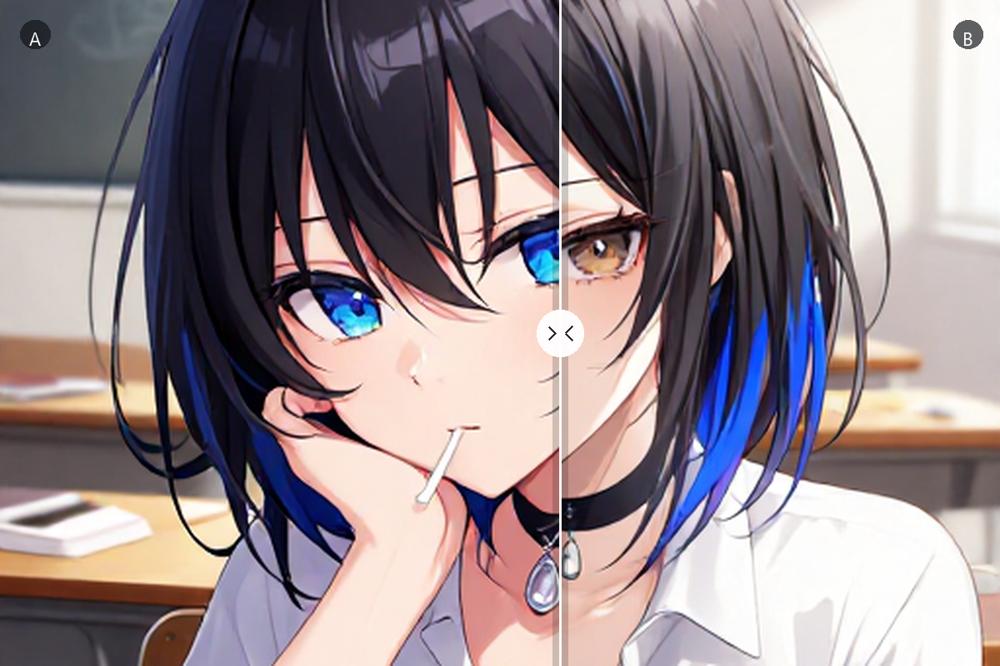

# DSH Image Compare

A left-sidebar image comparison panel for **DeepSeek Harness**. Load two images, overlay them, and move the pointer left/right to wipe between A and B with a smooth, eased reveal.



> 给 DeepSeek Harness 加一个「图片对比」侧栏页面：两张图重叠，鼠标左右移动即可丝滑擦除对比。

## Features

- **Native left-sidebar entry** — registers through `sidebar.panellist` plus the matching `main` panel key. No iframe, no separate app.
- **Load images three ways** — click a card, drag & drop, or paste from the clipboard with `Ctrl/⌘ + V`.
- **Smooth pointer reveal** — the split follows the pointer and is eased with `requestAnimationFrame`, so hover and drag both feel fluid.
- **Clean divider by default** — just a thin line, with no handle or number; toggle **百分比** in the toolbar to show the draggable handle and live split percentage.
- **Draggable divider** — grab the split line at any time; double-click the canvas to reset to 50%.
- **Keyboard support** — `←` / `→` for 2% steps, `Shift` for 10%, `Home` / `End` for the extremes.
- **Fit or fill** — toggle between `contain` and `cover` without reloading either image.
- **Swap and reset** — exchange A/B or restore the default view from the toolbar.
- **Theme aware** — uses DSH theme tokens (`--dsw-alias-*`) and a neutral checkerboard stage.
- **Local only** — images are read from the file picker or clipboard into object URLs. Nothing is uploaded or sent to a model.

## Install

### From GitHub

```bash
dsh plugin --profile your-profile add github:PaleLand/dsh-image-compare
```

Then restart DeepSeek Harness and click **图片对比** in the left sidebar.

### From a local folder

1. Clone or download this repository.
2. Open DSH → **Plugins** → **Add plugin** and choose the repository folder (it contains `package.json`).
3. Restart DSH if the sidebar does not refresh.

The package is a plain local bundle: no build step, no server, no extra runtime dependencies.

## Usage

1. Open **图片对比** from the left sidebar.
2. Add an image to **图 A** and another to **图 B** — click the cards, drop files on them, or paste an image.
3. Move the pointer across the canvas to compare. Drag the divider to pin a position, or use the keyboard for precise steps.
4. Use **适配 / 填充** to switch between contain and cover, **交换** to swap the layers, and **复位** to return to 50%.

## How it works

| File | Purpose |
| --- | --- |
| `package.json` | Bundle manifest; declares `dsh.bundle.patch` and the Web client entry. |
| `cordis.patch.yml` | Inserts the `image-compare` plugin row. |
| `index.js` | Host half — intentionally empty. |
| `client.js` | Browser half: slot registrations, the panel UI, pointer/keyboard handling, and styles. |
| `icon.svg` | Sidebar icon. |

The client registers `sidebar.panellist` with `id: image-compare` and the matching `main` panel key. The panel keeps two object URLs, draws both images in the same stage, and clips the top layer with `inset(0 0 0 P%)`. A small `requestAnimationFrame` loop eases the displayed position toward the pointer target.

## Compatibility

Built and tested against **DSH 0.2.2-rc.3** on Windows. The plugin relies on the client slot contract from that release; older DSH versions may not expose the same sidebar and main-panel slots.

## Privacy

The plugin has no network calls. Images are opened locally through the browser file picker or clipboard and kept as in-memory object URLs for the current page session.

## License

MIT — see [LICENSE](LICENSE).
