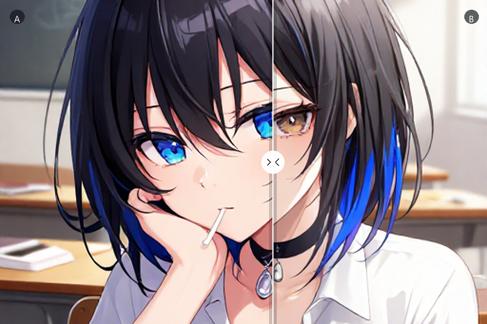

# DSH 图片对比

给 **DeepSeek Harness** 的左侧栏加一个「图片对比」页面：加载两张图，重叠在一起，鼠标左右移动就能丝滑擦除对比。



## 功能

- 左侧栏原生入口，通过 `sidebar.panellist` 和 `main` 面板插槽注册，不是 iframe。
- 三种加载方式：点击卡片、直接拖入图片、按 `Ctrl/⌘ + V` 粘贴。
- 鼠标跟随擦除，`requestAnimationFrame` 缓动，悬停和拖动都平滑。
- 分割线默认不显示百分数，画面更干净；需要时点工具栏 **百分比** 打开。
- 分割线可直接拖动，双击画面复位到 50%。
- 键盘：`←` / `→` 微调 2%，按住 `Shift` 微调 10%，`Home` / `End` 到两端。
- 适配 / 填充切换，交换 A/B，一键复位。
- 跟随 DSH 明暗主题，使用 `--dsw-alias-*` 主题变量。
- 纯本地处理，不上传图片、不调用模型。

## 安装

### 从 GitHub 安装

```bash
dsh plugin --profile 你的profile add github:PaleLand/dsh-image-compare
```

安装后重启 DeepSeek Harness，在左侧栏点击 **图片对比**。

### 从本地文件夹安装

1. 克隆或下载本仓库。
2. 打开 DSH → **插件** → **添加插件**，选择本仓库文件夹（里面有 `package.json`）。
3. 如果侧栏没有立即出现，重启一次 DSH。

## 使用

1. 点击左侧栏 **图片对比**。
2. 在 **图 A** 和 **图 B** 卡片上分别加载两张图片。
3. 鼠标在画面上左右移动即可对比；拖动分割线可固定位置，键盘可精细调整。
4. 工具栏可以切换适配 / 填充、交换左右图、显示 / 隐藏百分比、复位分割线。

## 兼容性

在 **DSH 0.2.2-rc.3**（Windows）上开发和验证。插件依赖该版本的客户端插槽契约，更旧的 DSH 版本可能不显示入口。

## 许可证

MIT，详见 [LICENSE](LICENSE)。
